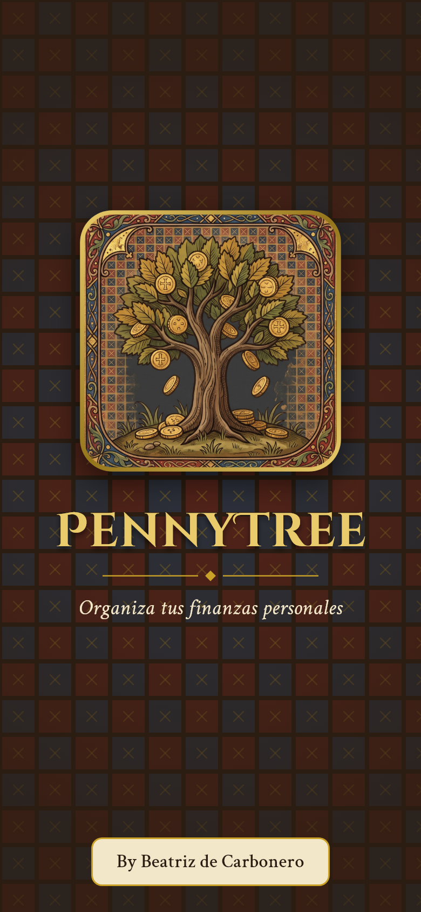
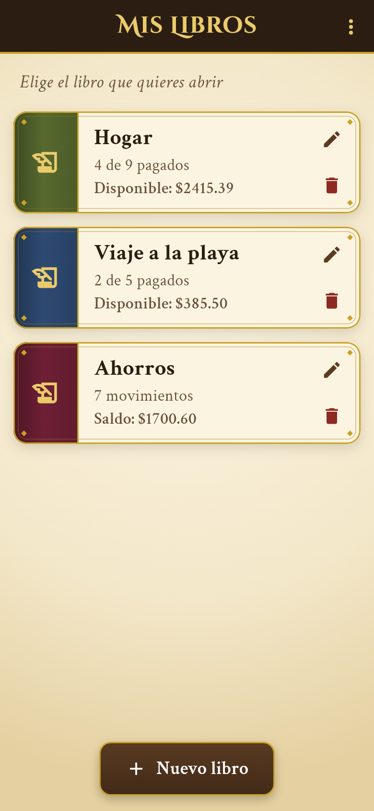
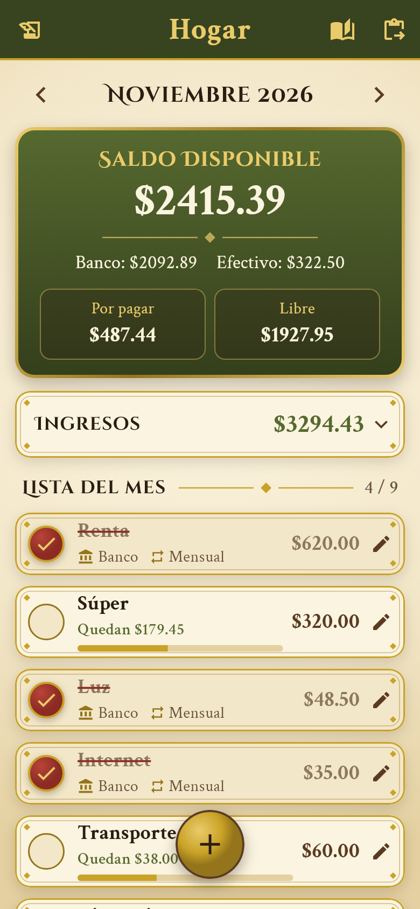
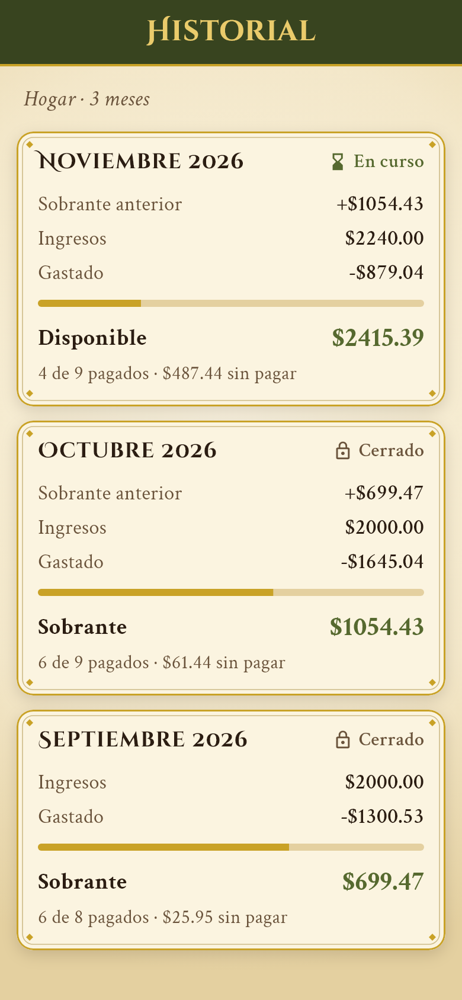
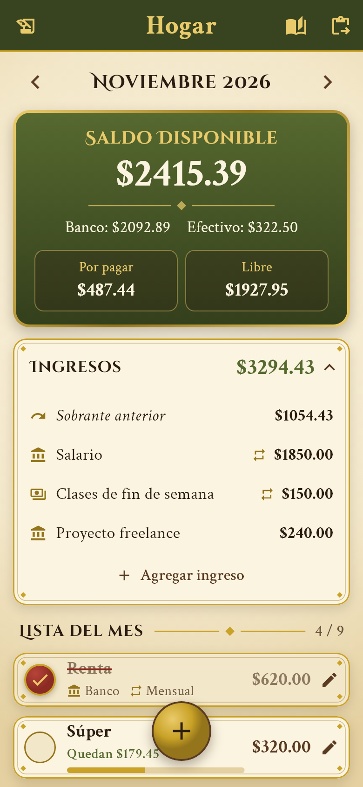
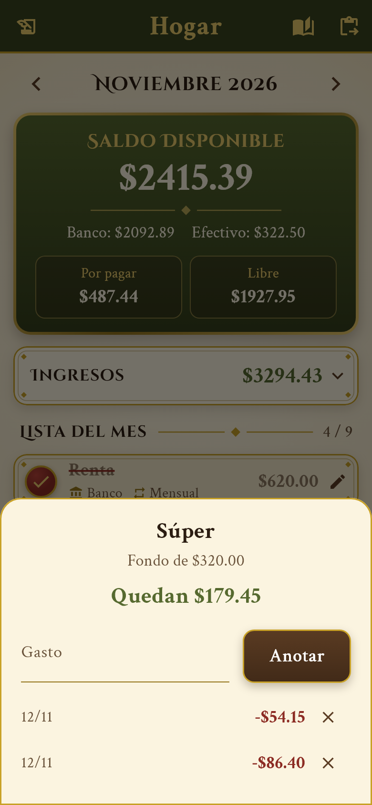
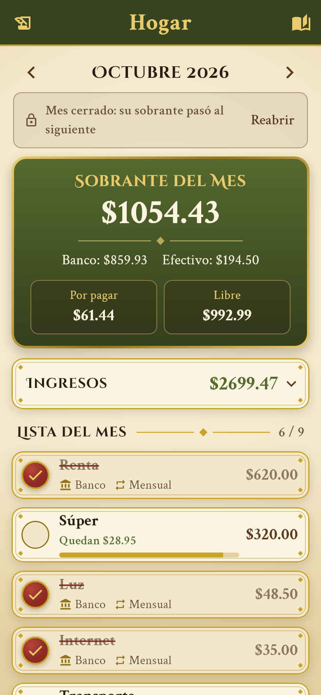
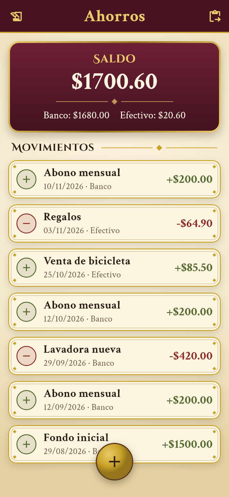
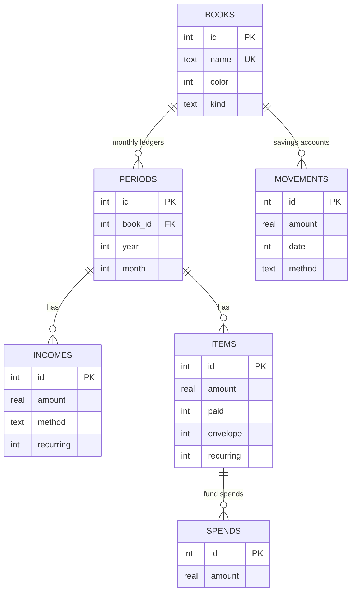
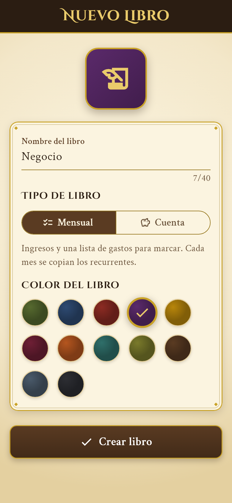

<div align="center">


# PennyTree

A local-first personal finance app inspired in a medieval theme as a flexible solution to manage daily and monthly budget (and yes, the name comes from Ser Arland of Pennytree! 🛡️)

It includes monthly checklists that subtract with one tap, funds you spend little by little, and a balance that rolls from one month to the next — all stored on your device.


</div>

<p align="center">
  
  
  
  
</p>

> The interface is in Spanish. Every screenshot uses made-up sample data.

## Why I built it

I used to run my household budget from a notes app: a checklist of recurring
bills that I copied and pasted into a new note every month, doing the sums by
hand. PennyTree turns that habit into an app — the list copies itself, the
arithmetic is automatic, and nothing leaves the phone.

It began as a university project backed by a cloud database. I rebuilt it
around a local SQLite database, redesigned the data model for multiple
independent ledgers, and gave it a visual identity drawn from its icon.

## Features

- **Multiple ledgers.** Keep separate books (home, a trip, savings), each with
  its own name and heraldic colour.
- **Monthly checklist.** List the month's bills and tap one to mark it paid;
  the available balance updates instantly.
- **Recurring items.** When a new month starts, the app opens a fresh sheet
  with every recurring income and bill, unchecked. One-off expenses stay behind.
- **Funds.** Set aside an amount (groceries, transport) and log partial spends
  against it; a progress bar shows what is left.
- **Calendar-based closing.** Past months lock automatically and their leftover
  balance carries into the next month, split between bank and cash. A closed
  month can be reopened to fix a mistake, and later months adjust themselves.
- **History.** One card per month: carried-over balance, income, spending and
  what was left.
- **Savings accounts.** A second ledger type with deposits and withdrawals and
  a running balance, with no monthly cut-off.
- **Plain-text import and export.** Back up every ledger to a readable `.txt`
  file, restore it on another device, or import a list written by hand.
- **Fully offline.** No account, no sync, no internet permission.

<p align="center">
  
  
  
  
</p>

## How a month works

| Concept | Meaning |
| --- | --- |
| **Available** | Carried-over balance + income − everything paid or spent so far |
| **To pay** | Unchecked bills plus what remains in each open fund |
| **Free** | What will be left once everything pending is paid |
| **Leftover** | The available balance when the month closes; it becomes next month's carry-over |

The carry-over is never stored. It is computed from the earlier months every
time it is needed, so correcting an old month flows through to every month
after it without any recalculation step.

## The text format

Export writes this format and import reads it back. It is deliberately close to
how people already write budgets in a notes app, so an existing note needs
little more than a `# Name` heading per ledger.

```text
# Home
+ 1850 Salary
+ 240 Freelance project #unavez
[ ] 320 Groceries ( -86.40 -54.15 = 179.45 )
[v] 620 Rent
[ ] 40 Birthday gift #efectivo #unavez

# Savings
2026-09-02 + 200 Monthly deposit
2026-09-18 - 420 New washing machine
```

| Syntax | Meaning |
| --- | --- |
| `# Name` | Starts a ledger |
| `[ ]` / `[v]` | A checklist item, unpaid or paid |
| `( -a -b = c )` | Marks the item as a fund and lists its partial spends |
| `+` / `-` | Income or deposit / withdrawal |
| `== 2026-11` | Starts a specific month (optional; defaults to the current one) |
| `#efectivo` | Paid in cash instead of bank |
| `#unavez` | One-off: not copied to the next month |

Importing never deletes anything: data is added to a ledger with the same name
or a new ledger is created. The whole import runs in one transaction, so a file
with an invalid value changes nothing.

## Tech stack

| Area | Choice |
| --- | --- |
| Framework | Flutter 3.29, Dart 3.7 (Material 3) |
| Storage | SQLite through `sqflite`, with `sqflite_common_ffi` for desktop and tests |
| Files | `file_picker` — the system picker only; no storage permission |
| Localisation | `flutter_localizations`, `intl` |
| Typography | Cinzel Decorative and Crimson Text, bundled (SIL Open Font License) |
| Tooling | `flutter_lints`, `flutter_launcher_icons`, `image` |
| Platforms | Android (primary), iOS, Windows, macOS, Linux |

There is no state-management package: screens are `StatefulWidget`s that read
from a single database class. For an app this size that keeps the data flow
easy to follow.

## Architecture

```text
lib/
├── main.dart               App entry point and database start-up
├── models/                 Plain data classes and their validation rules
├── services/
│   ├── app_database.dart   Schema, migrations and every query
│   └── backup_files.dart   Thin wrapper over the system file picker
├── utils/
│   ├── note_import.dart    Line parser for checklists and movements
│   └── backup.dart         Text backup format: parse and write
├── theme/                  Colour palette, typography, page transitions
├── screens/                One file per screen
└── widgets/                Reusable themed components
```



A few decisions worth pointing out:

- **Derived, not stored.** Balances, pending amounts and the carry-over are
  computed from rows rather than kept in columns, so they cannot drift out of
  sync.
- **Validation in two layers.** The Dart layer validates before writing, and
  the schema repeats the rules as `CHECK`, `UNIQUE` and foreign-key constraints.
- **Versioned schema.** A migration moves version 1 data (one budget and a flat
  expense list per ledger) into the current model without changing any balance.
- **Parameterised queries only.** No SQL is ever built from user text.

## Design

The look comes from the app icon: a coin tree in the style of a medieval
illuminated manuscript. Parchment surfaces, gold-leaf borders, a diaper-pattern
background painted in code, and ledger colours taken from heraldic tinctures.

Motion is short and quiet: buttons compress slightly when pressed, screens fade
and rise into place, amounts count to their new value, list items arrive in a
soft stagger, and the paid checkbox stamps like a wax seal.

<p align="center">
  
</p>

## Testing

108 automated tests run against a real SQLite engine (in memory), not a mock.

| Suite | Covers |
| --- | --- |
| `database_test` | Ledgers, monthly sheets, funds, month rollover, v1 → v2 migration |
| `closing_test` | Carry-over chains, deficits, calendar status, closed-month locking, history |
| `backup_test` | Text format parsing, full export → import round trip, merge rules |
| `import_test` | Parsing hand-written checklists and movement lists |
| `security_test` | SQL injection attempts, input validation, schema constraints, no network code |
| `widget_test` | Every screen and form through real user interactions |

```bash
flutter test
```

The README screenshots are generated the same way — by rendering the real
screens over sample data, with no device involved:

```bash
flutter test tool/screenshots_test.dart
```

## Privacy and security

- All data lives in an app-private SQLite database on the device.
- The Android app declares **no internet permission**, and a test fails if
  networking code is ever added.
- Android cloud backup is disabled, so the database is not copied off the
  device.
- Files are opened and saved only through the system picker, one user-chosen
  file at a time. Imports are size-limited and treated as untrusted text.

## Getting started

Requires the [Flutter SDK](https://docs.flutter.dev/get-started/install) 3.29 or newer.

```bash
git clone https://github.com/Bee-44/Personal_Finance_App.git
cd Personal_Finance_App
flutter pub get
flutter run
```

To build an installable Android package:

```bash
flutter build apk --release
```

## Roadmap

- English localisation
- Custom budget periods (for example, from payday to payday)
- Charts in the history screen
- Reserved amounts inside a savings account

## Author

**Beatriz de Carbonero** — [@Bee-44](https://github.com/Bee-44)

## License

Released under the [MIT License](LICENSE).

The bundled fonts are distributed under the SIL Open Font License; their
licence texts are in `assets/fonts/`.
